<p align="center"></p>

# yravgGrab — grab any product into builder-ready docs, ethically

## Preview



## The problem
Studying a competitor or reference product means hours of screenshots, scattered notes and half-remembered flows. Agents can do it fast — but usually with no plan, no evidence trail and no respect for site owners' AI opt-outs.

## What it does
`/grab <url or product>` runs a 9-step pipeline — **Gate → Research → Capture → Static analysis → Inventory → PRD → Roadmap → Package → Learn** — and hands you:
- `PRD.html` (one offline file, inline SVG + base64 screenshots) plus `PRD.md` and `PRD.pdf`, every figure captioned (screen, how to reach, what happens, markers, FR ids, source)
- `INVENTORY` with FR ids and a `PARITY-CHECKLIST` that defines "100%"
- `REF-ROADMAP.md` with numbered build steps and gap cards
- `HANDOFF.md` and ≤25 MB zips

Step 1 is a **mandatory AI-access gate**: robots.txt (incl. named AI agents), `Content-Signal`, `X-Robots-Tag: noai`, ai.txt/llms.txt and ToS. If AI agents are disallowed, it stops.



## Install
One line — copy the skill folder into your agent's skills directory.

**Claude Code**
```bash
cp -r grab ~/.claude/skills/        # or ./.claude/skills/ per project
```
**Cursor**
```bash
mkdir -p .cursor/skills && cp -r grab .cursor/skills/
```
**Codex / OpenClaw**
```bash
cp -r grab ~/.codex/skills/          # or reference grab/SKILL.md from AGENTS.md
```
**Any other agent:** paste `grab/SKILL.md` into the system prompt or project instructions and keep `grab/templates/` next to it.

Then say: `/grab https://example.com`.

## What's in the box
```
grab/SKILL.md          the skill (triggers, rules, 9 steps)
grab/templates/        GATE, SOURCES, INVENTORY, PARITY-CHECKLIST, PRD.md/.html, REF-ROADMAP, HANDOFF
LESSONS.md             recipes learned from real runs
assets/                animated SVGs
docs/                  GitHub Pages landing
```

## Requirements
An agent with shell + web access; a headless Chrome/Chromium. Optional: REA, the self-learning loop, yt-dlp, ffmpeg, poppler.

## What it's not for
- Bypassing logins, paywalls, CAPTCHAs, rate limits or licences
- Sites that opt out of AI agents
- Cloning or redistributing someone else's assets, code or content
- Scraping personal data

## Responsible use
- Respect robots.txt, AI opt-out signals (Content-Signal, `X-Robots-Tag: noai`, ai.txt) and each site's terms. The gate stops the run if AI agents are disallowed; don't disable it.
- Never bypass logins, paywalls, CAPTCHAs, rate limits or licences, and never collect personal data.
- Use captures for study and inspiration. Don't clone or redistribute someone else's assets, code, copy or brand.
- You are responsible for how you use this skill.

## Credits
- [REA](https://github.com/morluto/rea) by morluto — static analysis.
- [reverse-engineer-anything self-learning loop](https://github.com/Speedrunlab/reverse-engineer-anything-self-learning-loop) by Speedrun AI Labs (MIT) — gate / define-100% / learn loop and parity templates.

Want to protect your own site from grab-style agents? See **yravgAntiGrab**.

## License
MIT © 2026 yraverage (Enrico Marlon). See [LICENSE](LICENSE) and [CHANGELOG](CHANGELOG.md).

Support the project: PAYMENT_URL
