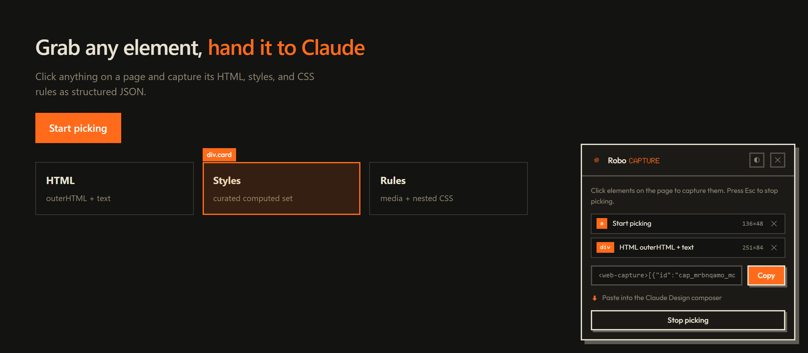

# Robo Capture

Element picker for Claude Design. Click the toolbar button, then click any element on a page - the extension grabs its HTML, curated computed styles, matching CSS rules (including inside `@media` / `@import` / nested rules), position, and page context. Copy the result as a `<web-capture>...</web-capture>` JSON block and paste it into the Claude Design composer.

## Install

1. Download or clone this repo
2. Open `chrome://extensions`
3. Toggle **Developer mode** (top right)
4. Click **Load unpacked** and pick this folder

## Use

- Click the **toolbar icon** - the panel appears bottom-right and picking starts (the hex mark pulses while picking).
- **Click elements** to capture them; each shows as a row (tag chip, label, size). Remove a row with its ✕.
- **Esc** or "Stop picking" pauses the picker so you can use the page normally. Click the toolbar icon (or "Pick more elements") to resume.
- **Copy** puts the full `<web-capture>` JSON on the clipboard - paste it straight into the Claude Design composer.
- **◐** toggles dark / light (persisted). **✕** removes the panel entirely.

## What each capture contains

| Field | What it is |
|---|---|
| `selector`, `tag`, `label` | approximate selector, tag name, readable label |
| `outerHTML`, `innerText` | the element's markup and text |
| `computedStyles` | curated set of ~40 layout/type/color properties, defaults filtered out |
| `cssRules` | every stylesheet rule that matches the element, with its media/supports condition |
| `rect` | position and size at capture time |
| `url`, `title`, `timestamp` | page context |

## Files

- `manifest.json` - MV3, on-demand injection (`activeTab` + `scripting`), no host permissions - the extension does nothing until you click its icon.
- `background.js` - toolbar click injects/toggles the content script.
- `content.js` - the whole tool. Panel + highlight box live in a shadow root so page CSS can't touch them.
- `fonts/` - bundled Outfit + Doto (latin subsets, OFL-licensed) served via `web_accessible_resources`. Strict-CSP pages may block them; the panel falls back to system fonts.

## Gotchas

- Won't run on `chrome://` pages or the Chrome Web Store (Chrome blocks injection there).
- Cross-origin stylesheets can't be read (`cssRules` throws) - those rules are skipped silently; computed styles still capture.
- The picker swallows page clicks while active by design; press Esc to interact with the page.

## License

CC BY 4.0 - free to use with attribution. Created by Jay from RoboLabs. Learn more at [RoboNuggets](https://robonuggets.com).
